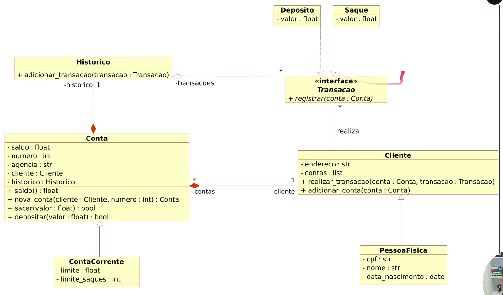

# Projeto de Sistema Bancario

Código para um sistema de acesso à contas bancárias em python ('desafio.py'). Foram aprimorado um arquivo base com implementação de Orientação a Objetos seguindo o seguinte esquema:

Modificações feitas a partir do código original em [https://github.com/digitalinnovationone/trilha-python-dio/blob/main/01%20-%20Estrutura%20de%20dados/desafio.py]

## Features

Existem 6 opções de operação bancária possíveis:
- Depositar
- Sacar
- Extrato
- Nova conta
- Listar contas
- Novo usuário (Pessoa Física)

## Autor

- [Gabriel Pinheiro](https://github.com/gabrielbopi/)

## Licença

[GPL3](https://choosealicense.com/licenses/gpl-3.0/)

